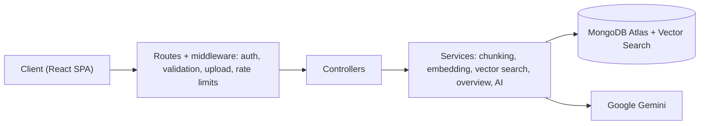

# DocMind Backend

REST API for [DocMind](https://github.com/ashutoshraw/docmind-frontend), a Retrieval-Augmented Generation (RAG) app that answers questions from uploaded documents and shows the sources it used.

**Live app:** https://docmind-frontend-psi.vercel.app
**Frontend repo:** https://github.com/ashutoshraw/docmind-frontend
**Health check:** https://docmind-backend-xgsq.onrender.com/api/health

> Hosted on a free tier, so the first request after a long idle period can take up to a minute.

## What it does

1. Accepts a PDF, text file or pasted text and splits it into overlapping chunks.
2. Turns each chunk into a 768-dimension embedding with Google Gemini and stores it in MongoDB Atlas.
3. For each question, finds the most similar chunks with Atlas Vector Search and asks Gemini to answer using only those chunks.
4. Detects overview questions ("summarize", "key points") and answers them from chunks sampled across the whole document, because vector search cannot match a question with no topic.

## API

All routes are under `/api`. Routes marked **protected** need an `Authorization: Bearer <accessToken>` header.

| Method | Route | Body | Returns |
|---|---|---|---|
| POST | `/auth/signup` | `{ name, email, password }` | `{ accessToken, user }` and sets the refresh cookie |
| POST | `/auth/login` | `{ email, password }` | `{ accessToken, user }` and sets the refresh cookie |
| POST | `/auth/refresh` | none (uses cookie) | `{ accessToken }` |
| POST | `/auth/logout` | none | clears the cookie and invalidates the session |
| GET | `/auth/me` | none | current user (**protected**) |
| POST | `/documents` | multipart `file` **or** JSON `{ title?, text }` | `202` with `{ document: { id, title, status, charCount } }` (**protected**) |
| GET | `/documents` | none | the user's documents with status (**protected**) |
| GET | `/documents/:id` | none | one document, used for status polling (**protected**) |
| DELETE | `/documents/:id` | none | deletes the document and its chunks (**protected**) |
| POST | `/chat/:documentId` | `{ question }` | `{ answer, sources: [{ chunkIndex, score }], messageId }` (**protected**) |
| GET | `/chat/:documentId/history` | none | past questions and answers for that document (**protected**) |
| GET | `/health` | none | `{ status, timestamp }` |

Uploads are limited to 10 MB. Titles are optional and capped at 100 characters. Document processing runs in the background: the upload returns `202` immediately, and the document moves from `processing` to `ready` or `failed`.

## Architecture



```
src/
  config/        Environment validation, database connection
  models/        User, Document, Chunk (with embedding), Message
  routes/        Route definitions
  controllers/   Request handlers (auth, documents, chat)
  middleware/    Auth, upload, validation, error handler
  services/      chunkingService, embeddingService, vectorSearchService,
                 overviewService, aiService, extractionService
  utils/         fetchWithRetry, token helpers
```

## Key design decisions

- **Chunking:** 1,200 characters with 200 overlap, maximum 150 chunks per document.
- **Retrieval:** cosine similarity, 50 candidates, top 4 chunks kept, filtered per user so documents are never shared across accounts.
- **Background ingestion:** embedding happens after the upload response, with batches of 3 and a pause between batches to stay inside free-tier rate limits. Any failure marks the document `failed` instead of leaving it stuck.
- **Grounded answers:** the prompt tells the model to answer only from the supplied chunks and to say when the answer is not there.
- **Resilient AI calls:** a shared `fetchWithRetry` helper retries 429/5xx responses, network failures and timeouts with exponential backoff and jitter (3 attempts, per-request timeouts). Generation falls back from `gemini-flash-lite-latest` to `gemini-flash-latest`. API keys travel in headers, not URLs.
- **Auth:** access token (15 min) plus refresh token (7 days) in an httpOnly cookie. The refresh token is stored hashed in the database, so a database leak does not expose usable tokens.
- **Rate limiting:** 10 requests / 15 min on auth, 10 / min on chat, 300 / 15 min globally, per client IP. `trust proxy` is set to 4 to match the Vercel, Cloudflare and Render proxy chain; if the hosting setup changes, re-check this value.
- **Safe errors:** expected client errors (4xx) return their message; unexpected errors (5xx) return a generic message to the client while full details stay in the server logs.
- **Hardening:** helmet, compression, graceful shutdown, input validation.

## Environment variables

Create a `.env` file in the project root:

| Variable | Purpose |
|---|---|
| `PORT` | Port the server listens on (for example `5000`) |
| `NODE_ENV` | `development` or `production` |
| `MONGO_URI` | MongoDB Atlas connection string |
| `JWT_ACCESS_SECRET` | Secret for signing access tokens |
| `JWT_REFRESH_SECRET` | Secret for signing refresh tokens (use a different value) |
| `GEMINI_API_KEY` | Google AI Studio API key |
| `CLIENT_URL` | Frontend origin allowed by CORS, with no trailing slash (for example `http://localhost:5173`) |

Generate secrets with:

```bash
node -e "console.log(require('crypto').randomBytes(64).toString('hex'))"
```

## Atlas Vector Search index

Create a vector search index on the `chunks` collection:

- **Index name:** `chunk_vector_index`
- **Path:** `embedding`
- **Dimensions:** 768
- **Similarity:** cosine
- **Filter fields:** the fields used in the `$vectorSearch` filter in `src/services/vectorSearchService.js` (documents are filtered by owner)

## Run locally

```bash
git clone https://github.com/ashutoshraw/docmind-backend.git
cd docmind-backend
npm install
# create .env as described above
npm run dev
```

The API starts on the port from your `.env`. Run the [frontend](https://github.com/ashutoshraw/docmind-frontend) alongside it and set `CLIENT_URL` to the frontend's address.

## Known limitations

- No automated test suite yet.
- No password reset flow.
- Answers are returned in one piece rather than streamed.

## Author

Built by Ashutosh Singh ([@ashutoshraw](https://github.com/ashutoshraw)).
